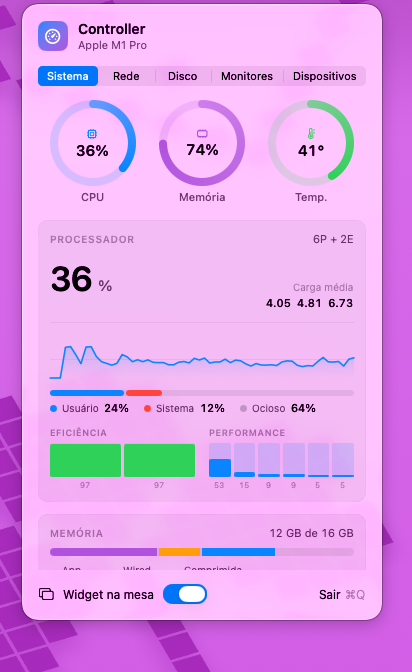

# Vitals OSX Monitor

**EN** · [PT-BR](#português)



**Vitals** is a lightweight menu bar app for **macOS (Apple Silicon)** that shows the vital signs of your Mac at a glance — CPU, memory, temperatures, network, disk space and the battery of your devices — and lets you adjust external monitors over DDC/CI. Written in Swift/SwiftUI, no dependencies, ~500 KB.

### Features

- **System** — total and per-core CPU (efficiency and performance clusters), user/system split, load average, history chart; memory (app, wired, compressed, swap); CPU, SSD and battery temperatures.
- **Network** — live download/upload rates with charts, peaks and totals since boot.
- **Disk** — free space on the startup volume (including purgeable space) and the size of the main folders (Applications, Desktop, Documents, Downloads, Pictures, Movies, Music, Library, Trash…).
- **Disk analyzer** — a separate window with an interactive sunburst chart (6 levels), folder contents sorted by size, an inspector with details and the largest files, and actions: Reveal in Finder, Open, Copy path, Move to Trash.
- **Monitors** — brightness, contrast and volume of external displays via DDC/CI, with presets; software (gamma) fallback for monitors that don't speak DDC.
- **Devices** — battery of AirPods, keyboards, mice (Bluetooth and BLE) and of iPhone, iPad and Apple Watch (USB or Wi-Fi sync).
- **Desktop widget** — a compact CPU / memory / temperature / network widget pinned to the desktop.
- **Energy-aware** — sampling slows down when the panel is closed, on battery and in Low Power Mode; network, folder sizes and devices are only read when someone can see them.

### Install

Download **`Vitals-1.0.dmg`** (drag to Applications) or **`Vitals-1.0.pkg`** (installer) from the [Releases](../../releases) page.

The app is not notarized (ad-hoc signed). On first launch, right-click **Vitals.app → Open**, or allow it in **System Settings → Privacy & Security**. Alternatively:

```sh
xattr -dr com.apple.quarantine /Applications/Vitals.app
```

Requirements: macOS 14 Sonoma or later, Apple Silicon (temperatures and DDC rely on Apple Silicon interfaces).

**Permissions.** macOS will ask for access to Desktop, Documents and Downloads (folder sizes) and to Bluetooth (device batteries). To measure the Trash and protected parts of the Library, grant **Full Disk Access** to Vitals.

### Build from source

Needs Xcode Command Line Tools (Swift 6).

```sh
./build.sh              # → build/Vitals.app
./Scripts/package.sh    # → dist/Vitals-<version>.pkg and .dmg
```

### Caveats

- Temperatures, DDC and the iPhone/Watch battery use private Apple interfaces (IOHID sensors, IOAVService, MobileDevice). They may change in future macOS versions.
- DDC/CI must be enabled in the monitor's on-screen menu. Some monitors don't report their current values; Vitals then shows an estimate.
- iPhone/iPad/Watch must trust this Mac, and be plugged in or have "Show this device when on Wi-Fi" enabled in Finder.

---

## Português

**Vitals** é um app leve de barra de menus para **macOS (Apple Silicon)** que mostra os sinais vitais do Mac num relance — CPU, memória, temperaturas, rede, espaço em disco e bateria dos seus dispositivos — e permite ajustar monitores externos via DDC/CI. Feito em Swift/SwiftUI, sem dependências, ~500 KB.

### Recursos

- **Sistema** — CPU total e por núcleo (eficiência e performance), divisão usuário/sistema, carga média, gráfico de histórico; memória (app, wired, comprimida, swap); temperaturas da CPU, SSD e bateria.
- **Rede** — taxas de download/upload em tempo real com gráficos, picos e totais desde o boot.
- **Disco** — espaço livre no volume de inicialização (incluindo o purgável) e o tamanho das pastas principais (Aplicativos, Mesa, Documentos, Downloads, Imagens, Filmes, Música, Biblioteca, Lixeira…).
- **Análise de disco** — janela própria com gráfico de anéis interativo (6 níveis), conteúdo da pasta ordenado por tamanho, painel de detalhes com os maiores arquivos e ações: Mostrar no Finder, Abrir, Copiar caminho, Mover para o Lixo.
- **Monitores** — brilho, contraste e volume de monitores externos via DDC/CI, com predefinições; brilho por software (gama) para monitores sem DDC.
- **Dispositivos** — bateria de AirPods, teclados, mouses (Bluetooth e BLE) e de iPhone, iPad e Apple Watch (USB ou sincronização por Wi-Fi).
- **Widget na mesa** — widget compacto de CPU / memória / temperatura / rede fixo na área de trabalho.
- **Econômico** — a amostragem desacelera com o painel fechado, na bateria e no Modo de Pouca Energia; rede, tamanhos de pastas e dispositivos só são lidos quando há alguém olhando.

### Instalação

Baixe **`Vitals-1.0.dmg`** (arraste para Aplicativos) ou **`Vitals-1.0.pkg`** (instalador) na página de [Releases](../../releases).

O app não é notarizado (assinatura ad-hoc). Na primeira vez, clique com o botão direito em **Vitals.app → Abrir**, ou permita em **Ajustes do Sistema → Privacidade e Segurança**. Ou então:

```sh
xattr -dr com.apple.quarantine /Applications/Vitals.app
```

Requisitos: macOS 14 Sonoma ou posterior, Apple Silicon.

**Permissões.** O macOS vai pedir acesso a Mesa, Documentos e Downloads (tamanho das pastas) e ao Bluetooth (bateria dos dispositivos). Para medir a Lixeira e áreas protegidas da Biblioteca, conceda **Acesso Total ao Disco** ao Vitals.

### Compilar

Requer as Command Line Tools do Xcode (Swift 6).

```sh
./build.sh              # → build/Vitals.app
./Scripts/package.sh    # → dist/Vitals-<versão>.pkg e .dmg
```

### Observações

- Temperaturas, DDC e bateria do iPhone/Watch usam interfaces privadas da Apple (sensores IOHID, IOAVService, MobileDevice) e podem mudar em versões futuras do macOS.
- O DDC/CI precisa estar ativado no menu do monitor. Alguns monitores não informam os valores atuais; nesse caso o Vitals mostra uma estimativa.
- iPhone/iPad/Watch precisam confiar neste Mac e estar conectados por cabo ou com "Mostrar este dispositivo quando estiver na rede Wi-Fi" ativado no Finder.
